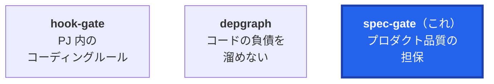
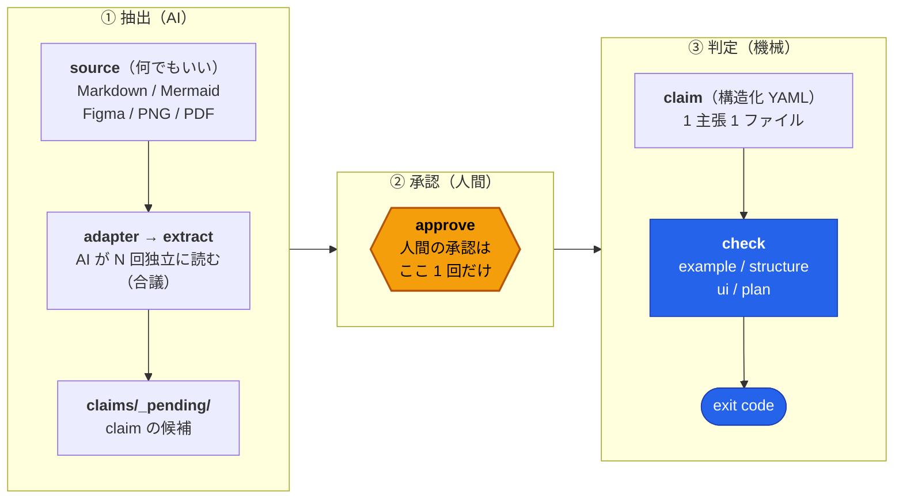
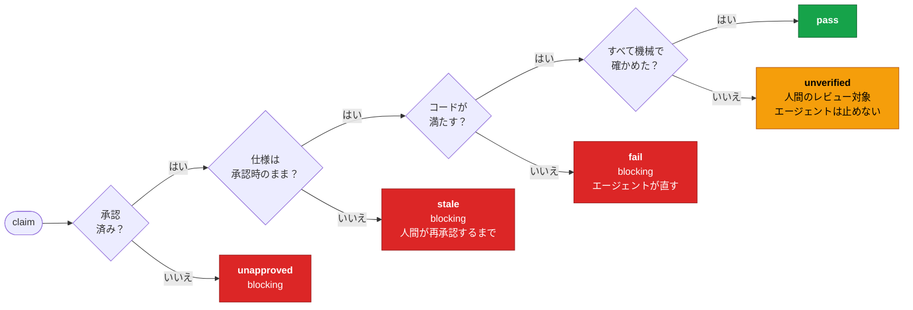
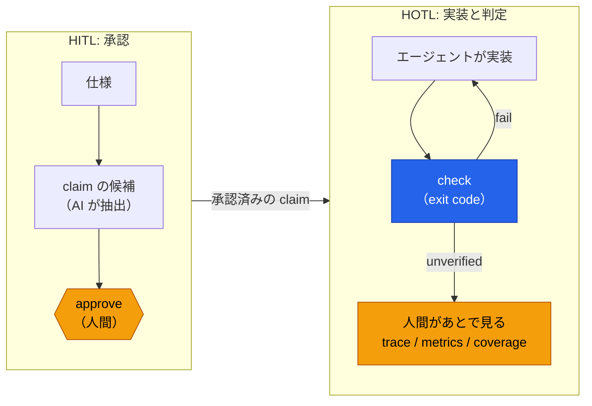

[English](README.md) | 日本語

# spec-gate — 仕様準拠ハーネス



自然言語の仕様（Markdown / Mermaid / Figma / 画像）と、エージェントと作ったプランファイルが
**AI の書いたコードで守られているか**を、エージェントの自己申告を一切使わず exit code で判定する。

設計思想は 1 つ：**AI は嘘をつく前提で、判定を機械に寄せる。モデルが賢くなればハーネスは素通りになり、往復が減る。**

## 仕組み



自然言語とコードを直接照合はしない。間に **claim（検証可能な主張）** を挟む。

| 工程 | コマンド | 誰が | 何が起きる |
|---|---|---|---|
| 抽出 | `spec-gate extract <ref> --runs 3 --emit` / `--collect` | AI（サブエージェント） | 同じ仕様を独立したサブエージェントが N 回読み、一致した主張だけ高信頼にして `claims/_pending/` へ（合議）。[extract / reverse のサブエージェント委譲](#extract--reverse-のサブエージェント委譲)を参照 |
| 整合 | `spec-gate lint` | 機械 | examples が properties を満たすか、holdout の形が正しいか、claim 同士が矛盾しないか |
| 承認 | `spec-gate approve <id>` | **人間** | 仕様の該当箇所を表示し、ハッシュを凍結。lint 失敗なら拒否 |
| 承認 UI | `spec-gate review` | **人間** | `claims/_pending/` を仕様の抜粋つきで平易に並べるローカルの Web ページ（127.0.0.1）。候補ごとに承認・却下・曖昧を選ぶ。承認すると `claims/<領域>/` に移して `approve` する |
| 承認 UI（リモート） | `spec-gate mcp`（`.mcp.json` から起動） | **人間** | リモートセッション（claude.ai/code・スマホの Claude アプリ）でも開ける MCP Apps の画面。承認しやすい順に並べ、承認・却下・曖昧・まとめ承認をタップで決める。下の「承認 UI（MCP Apps）」を参照 |
| リモート承認 | `spec-gate review ask` → 質問ダイアログ | **人間**が回答 | リモートセッション向けに、同じ 3 つのボタンを Claude Code の質問ダイアログに出す。下の「リモート承認」を参照 |
| 判定 | `spec-gate check` | 機械 | 承認 → 仕様ドリフト → 種類別チェック（examples・holdout・fuzz）→ プランの verify |
| 漏れ | `spec-gate coverage` | 機械 | 仕様のうち claim に紐づかない箇所と、曖昧と記録された箇所（要確認）を列挙 |
| 逆変換 | `spec-gate reverse [<id>...] --emit` / `--collect` | AI（サブエージェント） | 仕様を見せずに claim だけから仕様文を書き起こし、原文の該当箇所と比べて、claim にだけある主張・抜けている規範・矛盾を列挙（レビュー補助。`--strict` で食い違いがあれば exit 1） |
| 自動承認 | `spec-gate auto-approve <ref> --area <領域>` | 承認役のサブエージェント | 人間が書いた方針（`.spec-gate/policy.yaml`）のコマンドだけで抽出・逆変換・試し実行をし、方針と証拠が認めた候補だけを承認する（承認者 `auto`、証拠は `.spec-gate/evidence/`）。`docs/spec/auto-approval.md` |
| 見張り | `spec-gate audit [--since 24h]` | 誰でも | 自動承認を新しい順に一覧する（合意数・逆変換・試し実行・証拠・差し戻し済みか） |
| 差し戻し | `spec-gate revoke <ID> --reason <理由>` | **人間** | 承認を取り消して `claims/_pending/` に戻す。差し戻しが続くと自動承認はブレーカーで止まる |

### 判定の順序と状態

`check` は claim ごとに次の順で見て、最初に引っかかった段階で止まる。



blocking があれば exit 1。`--hook` では stderr に直すべきものだけのレポートを出して exit 2。

`kind: example` の fail には、examples・holdout・
[ランダム入力](#fuzz-と-relations--ランダム入力による検証)のどれで落ちたものも含まれる。
Markdown の claim が参照する見出しが仕様から消えたとき（`source.ref` の見出しが無いとき）は「仕様を読めない」で fail になり、
説明に最も近い見出しを「もしかして」として添える。近さは見出しの文字単位の編集距離で、距離が見つからない見出しの文字数の半分以下の
ものだけを提案し、同点なら仕様の中で先に現れる見出しを選ぶ。提案だけで claim は書き換えない（直すのは人間）。

### 誰が何をするか

| 人間だけが行う | エージェント（誰でも）が行う |
|---|---|
| `approve`、`review`（ブラウザでの承認・却下・曖昧） | `status`・`lint`・`check`・`coverage`・`metrics`・`trace`・`leak` |
| リモート承認のダイアログへの回答 | `review ask`（ダイアログに出す質問の生成） |
| `plan freeze` | `verify:` 付きのプランを書く、`plan check`、`plan mutate` |
| `holdout add` | `extract` / `reverse` の `--emit` / `--collect`（LLM 処理はサブエージェントに任せる） |
| `claims/**`（`_pending/` を除く）・`.spec-gate/`・`holdout/`・`.claude/settings*.json` の編集 | claim が間違っていると思ったら `claims/_pending/` に修正案を置き、人間に伝える |

「人間だけ」の列はお願いではなく強制される。hook-gate のルール（`.claude/feedback/`）がエージェントによるこれらのコマンドの実行と
パスの編集を拒否し、`review record`（リモート承認の hook）はハーネスだけが起動する。

### 嘘をつけない構造

- **claim は AI が触れない**。`claims/**` と `.spec-gate/` の編集、`approve` / `plan freeze` の実行を
  hook-gate の `pre_edit` / `pre_bash` ルールで拒否する（`.claude/feedback/protect_spec_claims.md`）。同じファイルで、
  `review record` の直接実行と、承認画面の `/api/approve`・`/api/reject`・`/api/ambiguous` をシェルから叩くことも拒否する
- **プランの verify は先に凍結する**。`spec-gate plan freeze` で verify 行のハッシュを記録し、
  実装後に verify を緩めると `stale` になる。加えて、プランを編集した直後に hook-gate の `post_edit` が
  `spec-gate plan check` を走らせ、凍結済みの verify が変わっていればその場で止める
  （`.claude/feedback/protect_plan_verify.md`）。プランによっては、壊したコードを verify が検出できることを
  凍結の条件にできる（[mutation score](#plan-mutate-と-mutation-の閾値)）
- **自動承認まわりも書き換えさせない**。`.claude/settings.json` の PreToolUse hook が `spec-gate guard` を呼び、
  `spec-gate auto-approve` を承認役のサブエージェント（`spec-gate-approver`）以外から実行すること、`spec-gate revoke` の実行、
  hook-gate の規則（`.claude/feedback/**`・`.claude/gate.yaml`）・承認役の定義・hook の設定・`.spec-gate/` の書き換え（シェル経由も）を拒否する
  （`docs/spec/auto-approval.md`）
- **仕様が変わったら自動で stale**。仕様側を書き換えて辻褄を合わせることもできない
- **検証手段のない claim は fail ではなく unverified**。「検証していないのに通った」を作らない代わりに、
  人間が見るべきものとして可視化する
- **examples だけ通しても通らない**。エージェントが読めない holdout、ランダム入力、例の値の直書きの警告、
  通り方のログで、よくある抜け道を塞ぐ（[抜け道を塞ぐ](#抜け道を塞ぐ)）

### 人間の関わり方 — HITL と HOTL

spec-gate は 2 つの関わり方を組み合わせている。「何が正しいか」を決めるところは
Human-in-the-loop（HITL）、「コードがそれを守っているか」を判定するところは Human-on-the-loop（HOTL）。



| | HITL（承認） | HOTL（実装と判定） |
|---|---|---|
| 何を決めるか | 仕様から作った claim が正しいか | コードが claim を満たすか |
| 人間がしないと | 進まない。未承認は `unapproved`、仕様が変わると `stale` で、人間が（再）承認するまで blocking | 進む。`fail` はエージェントが自分で直し、`unverified` はエージェントを止めない |
| 人間の道具 | 承認画面（`review`）、MCP Apps の承認 UI、リモート承認 | `trace`、`metrics` / `check --json`、`check --role`、`coverage` |

設計思想の「モデルが賢くなればハーネスは素通りになり、往復が減る」は、今は HOTL 側の話。賢いモデルほど一度で `check` を通し、
人間が見張るものが減る。HITL の承認は、モデルが賢くなっても今は減らない。

#### この先: 承認も HOTL に寄せる

モデルが賢くなれば、承認も「人間はゴールだけ渡し、あとは自然と回って、人間は見張るだけ」に寄せられるはずだ。ただし前提が 1 つある。
**claim を書いた AI と、その claim を正しいと認める者は別でなければならない**。同じ AI が書いて同じ AI が認めると、
「AI は嘘をつく前提」がそこで崩れる。だから承認を自動にするには、作者とは独立した確かめ方がそろっている必要がある。
今あるものは、その土台になる:

- **合議**（`extract --runs N`）: 互いの回答を見ない複数のサブエージェントが同じ主張を出したか
- **試し実行**（`# dry-run:`）: 候補の例が、今のコードで実際に通るか
- **逆変換**（`reverse`）: 仕様を見せずに claim から書き起こした文が、原文と食い違わないか
- **まとめ承認**（`approve --pending`、MCP Apps のまとめ承認）: 全員一致で、example なら試し実行も pass の候補だけをまとめて通す。
  今は最後のボタンを人間が押すが、条件そのものは機械が決めている
- **曖昧の記録**（`claims/_ambiguous/`）と `coverage`: 決めきれなかったものと、claim の無い仕様の箇所を人間に見せる

これらがすべて「問題なし」と言った候補は自動で承認し、人間は承認の記録（今はリモート承認と MCP Apps の分を `.spec-gate/review-decisions.jsonl` に残している）と `coverage` を見張って、
おかしければ差し戻す。そういう HOTL の承認に移れる。**まだ実装していない**。今の承認は HITL のまま。
移るとしても、ゴール（仕様そのもの）を決めるのは人間に残る。

## インストール

**GitHub Releases（推奨）。** [Releases](https://github.com/nonchan7720/spec-gate/releases) から OS / CPU に合うアーカイブを取得する。
`spec-gate_<os>_<arch>.tar.gz`（Windows は `.zip`）で、linux / darwin / windows × amd64 / arm64 がある。
`checksums.txt` で検証してから `spec-gate` を `PATH` に置く。どのアーカイブにも `LICENSE`・`NOTICE`・
`THIRD_PARTY_NOTICES.md` が入っている。

```bash
sha256sum --ignore-missing -c checksums.txt   # macOS: shasum -a 256 --ignore-missing -c checksums.txt
tar xzf spec-gate_linux_amd64.tar.gz && install spec-gate ~/.local/bin/
spec-gate --version
```

`v<version>-dev.<commit>` という名前のリリースは、`main` への push ごとに作られるプレリリース。

**Go で入れる。**

```bash
go install github.com/nonchan7720/spec-gate@latest
```

**ソースから。** リポジトリを clone し、`mise.toml` で固定したツールチェーンでビルドする：

```bash
git clone https://github.com/nonchan7720/spec-gate.git && cd spec-gate
mise run setup   # mise install、go mod download、サンプルアプリの npm 依存、bin/spec-gate
```

spec-gate は pure Go（`CGO_ENABLED=0`）なので、素の `go build` でクロスコンパイルできる。

## 動かす

```sh
go build -o spec-gate .                    # or: go run .
pnpm install --frozen-lockfile             # サンプルの TS 側（tools/call.ts 用）

./spec-gate status                         # claim とプランの一覧
./spec-gate lint                           # 内部整合
./spec-gate approve ROUND-001 ROUND-002 CLOSE-001 ARCH-001 UI-001   # 人間
./spec-gate check                          # 全判定
./spec-gate check --changed                # 変更ファイルに関係する claim だけ
./spec-gate coverage                       # 抜け落ちと要確認
./spec-gate plan check plans/x.md          # 凍結済みプランの verify が変わっていないか
./spec-gate plan mutate plans/x.md         # わざと入れたバグを verify がどれだけ検出するか
./spec-gate leak src/payroll/round.ts      # 例の値が実装に直書きされていないか
./spec-gate metrics                        # kind 別の件数と unverified 率
./spec-gate trace                          # claim がどう通ったか
```

サンプルは承認済みの状態で同梱してあるので、clone 直後の `check` は通る。
壊してみると分かりやすい：

```sh
sed -i 's/Math.floor/Math.round/' src/payroll/round.ts && ./spec-gate check --only ROUND-001
#  ✗ ROUND-001  fail  円未満は切り捨て  [docs/spec/rounding.md:10]
#        examples[0]: in=1234.56 期待=1234 実際=1235

sed -i '/infra: \[app\]/d' .depgraph.yml && ./spec-gate check --only ARCH-001
#  ✗ ARCH-001  fail  図（仕様）と .depgraph.yml が一致しない。.depgraph.yml を図に合わせること:
#        infra -> app は仕様で許可されていないが forbidden.infra に app が無い

sed -i 's/切り捨てる/四捨五入する/' docs/spec/rounding.md && ./spec-gate check --only ROUND-001
#  ⟳ ROUND-001  stale  仕様が承認後に変更された。内容を確認して approve で再承認する
```

### Claude Code との接続

判定は hook-gate（feedback-gate）の `.claude/gate.yaml` から走る。独自の Stop hook は持たない。

- 編集のたびに、変更したファイルに応じて gofmt / go vet / go test（Go）、`depgraph gate`（Go / TS / JS）、
  `spec-gate lint`（claims）、`spec-gate check --changed`（仕様・プラン・サンプルアプリ）が走る
- 実装ファイル（`.go` / `.ts` / `.js` など。テスト・`claims/`・`holdout/`・`docs/` は除く）を編集すると、
  `.claude/feedback/detect_literal_leak.md` の `post_edit` ルールがそのファイルに `spec-gate leak` を走らせて警告する
- 終了時に `consistency_checks` の `go-all`（build / golangci-lint / 全テスト）と
  `spec-gate`（`check --changed --hook`）が走り、失敗があれば終了をブロックする。
  連続失敗で諦める処理（5 回）は hook-gate 側が持つ

depgraph は `docker compose up -d` で起動する Neo4j（`localhost:17687`）を使う。接続先は `mise.toml` の `[env]` にあり、
depgraph は hook・gate とも `mise exec --` 経由で呼ぶ。`.claude/settings.json` の SessionStart hook（`depgraph hook session-start`）が
セッション開始時の基準を記録し、`depgraph gate` はそこから増えた負債だけで失敗する。

`CLAUDE.md` にエージェント向けのルールがある。extract / reverse 用のサブエージェント定義とスキルは
`.claude/agents/` と `.claude/skills/` に同梱している（次節）。

### extract / reverse のサブエージェント委譲

spec-gate 自身は LLM を呼ばない。`extract`（合議抽出）と `reverse`（逆変換）は **プロンプトの書き出し**（`--emit`）と
**回答の取り込み**（`--collect`）だけを行い、spec-gate を動かしているエージェントが各プロンプトを新しいサブエージェントに渡す。

- `extract <ref> --runs N --emit` は自己完結したプロンプトを `.spec-gate-llm/extract/<ref>/run-<k>.prompt.md` に N 個書き出し、
  パスを表示する。`extract <ref> --collect` は N 個の回答（`run-<k>.answer.md`）を読み、これまでと同じ合議で `claims/_pending/` に置く。
  回答が欠けていれば欠けている run を挙げて失敗する
- `reverse [<id>...] --emit` は claim ごとに再生成のプロンプトを書き出す。`reverse --collect` は、再生成の回答がそろえば比較の
  プロンプトを書き出し、比較の回答もそろえばレポートを出す（`--strict` で mismatch / error があれば exit 1）
- `.spec-gate-llm/` は git の管理対象外で、collect が終わると消える（エージェントの書き込みを禁止している `.spec-gate/` は使わない）
- `.claude/agents/spec-gate-llm-worker.md` は Read / Write だけを持つ使い捨ての担当者で、渡されたプロンプトファイル 1 つを読み、
  名指しされた回答ファイル 1 つに書く以外は何もしない。スキル `spec-gate-extract` / `spec-gate-reverse`（`.claude/skills/`）が手順を持つ:
  emit → プロンプト 1 つにつき新しいワーカーを 1 体、並列に起動し、`Read <プロンプトのパス> and follow it.` だけを渡す → collect。
  合議の独立性を保つため、ワーカーは使い回さず、ヒントも足さない

環境変数 `SPEC_GATE_EXTRACT_CMD` / `SPEC_GATE_REVERSE_CMD` を設定したときだけ、これまでどおりそのコマンド（`claude -p` など。
stdin にプロンプト、stdout に回答）を呼ぶ。変数を設定せず `--emit` / `--collect` も付けなければ、委譲の手順を案内して exit 1 にする
（意図せず LLM を呼ばない）。

```sh
spec-gate extract docs/spec/rounding.md#端数処理 --runs 3 --emit
#   （表示されたプロンプト 1 つにつき spec-gate-llm-worker を 1 体）
spec-gate extract docs/spec/rounding.md#端数処理 --collect

SPEC_GATE_EXTRACT_CMD='claude -p' spec-gate extract --type mermaid docs/arch/layers.mmd --runs 5
```

## ディレクトリ

先頭の 3 行が **source**（spec-gate が読む仕様）。

| パス | 中身 |
|---|---|
| `docs/spec/*.md` | 詳細仕様（Markdown） |
| `docs/arch/*.mmd` | アーキテクチャ図（Mermaid） |
| Figma / `*.png` / `*.pdf` | UI・その他 |
| `sources.yaml` | 監視する source の登録簿（coverage 用） |
| `claims/<領域>/*.yaml` | claim。書式は claims/SCHEMA.md |
| `claims/_pending/` | extract の出力。承認まで check 対象外 |
| `claims/_ambiguous/` | 「仕様が決まっていない」と記録した候補。check 対象外で、coverage が要確認として出す |
| `holdout/<id>.yaml` | holdout（入力と期待値のハッシュ）。書くのは人間だけ |
| `plans/*.md` | プラン。front matter の status: active で check 対象 |
| `.spec-gate/` | プランのロック（コミット対象）と trace.jsonl・review-decisions.jsonl（git 管理外） |
| `.spec-gate-llm/` | extract / reverse を委譲している間のプロンプトと回答（git 管理外、一時的） |
| `.depgraph.yml` | depgraph のレイヤー定義。図と一致していることを structure claim が照合する |
| `.claude/gate.yaml` | hook-gate の品質ゲート |
| `.claude/feedback/` | hook-gate のルール（claims・verify 行・holdout の保護、リテラル漏れの警告） |
| `.claude/agents/` | spec-gate-llm-worker（extract / reverse 用のサブエージェント） |
| `.claude/skills/` | spec-gate-extract / spec-gate-reverse（委譲の手順） |
| `tools/call.ts` | example claim の binding 用ラッパ（TS 関数向け） |
| `tools/bind` | docs/spec/harness.md（spec-gate 自身の仕様）の入出力例を検証する binding |

spec-gate 本体（Go）:

| パス | 中身 |
|---|---|
| `main.go` | エントリポイント |
| `pkg/domain` | Claim / Plan / Result、ポート、lint、fuzz、mutation、leak、relink（純粋） |
| `pkg/services` | check / approve / coverage / extract / reverse / plan / mutate / holdout / metrics / trace / review |
| `pkg/infrastructure` | claimrepo, adapter(markdown/mermaid/figma/image), checker, planfile, vcs, extractor, reverser, llmwork, tracelog, workspace |
| `pkg/interfaces` | cli（cobra コマンド、レポート、hook 出力）、handler/review（承認画面） |

## claim の種類と、何が機械的に守れるか

| kind | source の例 | 検証 | 確度 |
|---|---|---|---|
| `example` | 詳細仕様（端数・締め日） | binding コマンドに入出力例（と holdout の入力）を流し、properties（expr 式）も評価。ランダム入力とメタモルフィック関係も書ける | 高・決定的 |
| `structure` | Mermaid の図 | 図のエッジ（= 許可）と `.depgraph.yml` の layers / forbidden が一致するかを照合し、依存違反の検出は `depgraph scan` に任せる | 照合は決定的。検出は depgraph 次第 |
| `ui` | Figma | story に variant と同名の export があるか / `--ui` で Playwright が文言を確認 | 中 |
| `manual` | 何でも | なし。常に unverified | — |

`example` の binding は「stdin JSON → stdout JSON」の契約を満たすコマンドなら何でもよいので、
TS / Go / Python どれでも同じ claim で検証できる。

### fuzz と relations — ランダム入力による検証

examples の数件だけを満たす実装を落とすため、`example` の claim に `fuzz:` と `relations:` を書ける（書式は `claims/SCHEMA.md`）。

```yaml
fuzz:
  runs: 200            # 生成する入力の数（1〜10000）
  seed: 42             # 省略可。省略時は claim ID の 64 ビット FNV-1a ハッシュ
  input: { type: number, min: -100000, max: 100000 }   # number | integer。両端を含む
relations:             # メタモルフィック関係。x は生成した入力、f(...) は binding の呼び出し
  - "f(x + 1) == f(x) + 1"
```

`check` は examples がすべて一致したあとで、seed から `runs` 個の入力を決定的に生成し（同じ seed なら同じ入力列）、binding に流して
各 x について properties（`input` = x、`output` = 出力）と relations を評価する。最初に満たさない入力が見つかった時点で fail にし、
反例と seed を出す（その `seed:` を書けば再現できる）。`lint` は、relations には fuzz を、fuzz には properties か relations を、
relations には真偽を返す式を求める。

### holdout（エージェントに見せない入出力例）

holdout は、claim の examples とは別に `holdout/<claim-id>.yaml` に置く、エージェントに見せない入出力例。
シェルを使えるエージェントは利用者が読めるファイルを読めてしまうので、平文の holdout は隠し切れない。そこで **期待値はハッシュだけで持つ**:

```yaml
examples:
  - in: 98765.43
    out_sha256: 3f1c…   # 期待する出力の正規化 JSON の SHA-256（16 進小文字 64 文字）
```

- `check` は examples に続けて holdout の `in` を binding に流し、出力の正規化 JSON の SHA-256 を `out_sha256` と比べる。
  properties は holdout の入力と実際の出力で評価する。1 件でも不一致なら claim は fail で、レポートには
  **件数だけ**を出す（「holdout 2 件中 1 件が不一致（値は表示しない）」）。入力・期待値・実際の値は出さない
- 平文の `out`、`in` / `out_sha256` の欠落、形の崩れたハッシュは読み込みで拒否する。`lint` は形だけを確かめる
  （対応する claim があり `kind: example` であること）
- **holdout を足すのは人間だけ**: `spec-gate holdout add <claim-id> --in <json>` が期待する出力（JSON）を標準入力から読み、
  `in` と `out_sha256` を末尾に足す（ファイルが無ければ作る）。out の平文はどこにも保存も表示もしない。
  端末ならプロンプトを出してエコーなしで読み、端末でなければパイプ全体を読む
  （`spec-gate holdout add ID-001 --in '{"amount": 100}' < out.json`）。`--out -` は省略と同じ。
  `--out <json>` も動くが、値がシェル履歴に残るので警告を出す
- エージェントは `holdout/` を読めず、書けない。`.claude/settings.json` の `permissions.deny` に `Read` / `Edit` / `Write(./holdout/**)` があり、
  hook-gate が holdout を読み書きするシェルコマンド（`.claude/feedback/protect_holdout.md`）と `holdout add` の実行
  （`.claude/feedback/protect_holdout_add.md`）を拒否する。読むのは spec-gate 本体（`check` / `lint`）だけ

### structure と depgraph

図 = 仕様、depgraph = 検出器、spec-gate = 両者の整合。

1. claim の各層が `.depgraph.yml` の `layers` に同名であり、同じディレクトリ（`<dir>/**`）を指すこと
2. claim の層の全順序対 A→B について、図で許可された依存（claim の `forbidden` を除く）は depgraph が禁止しておらず、
   許可されていない依存は depgraph が禁止していること
3. 一致していれば `depgraph scan --root . --claude-md ''`（`SPEC_GATE_DEPGRAPH_CMD` で差し替え可）で今のツリーを全件スキャンし、
   claim の層どうしの `layer-violation` が 1 件でもあれば fail（セッション前からある違反も含む。CLAUDE.md は書き換えない）。
   depgraph が未インストール、Neo4j に届かない、スキャンが完了しないときは unverified

### source adapter

| type | ref | ハッシュの取り方 | coverage の単位 |
|---|---|---|---|
| markdown | `path.md#見出し` | 節の本文（空白は正規化） | 見出し |
| mermaid | `path.mmd` | エッジ集合（ラベル・配置は無視） | エッジ |
| figma | `figma://<fileKey>/<nodeId>` | ノード部分木（座標は除外）。要 `FIGMA_TOKEN` | テキストノード・variant |
| image | `path.png` | ファイルハッシュ | ファイル |

Figma / 画像のように AI が直接読めない source は、`extract` の精度は保証しない。
人間が承認する工程があるので、候補の質が低くても「間違いが混入する」ことはない。

### `check --changed` が判定し直すもの

`check --changed` は git の変更ファイルに関係する claim だけを判定する。見逃すより多めに判定する側に倒す。
claim が触るパスは、仕様ファイル・claim ファイル・`story`・`layers`、そして `binding` の語のうちリポジトリに実在するファイルまたは
ディレクトリを指すもの。変更ファイルが次のどれかなら、その claim は対象になる。

- 触るファイルそのもの、または触るディレクトリの配下
- 触るファイルと同じディレクトリにあり、拡張子が同じ（同じパッケージの別ファイル）
- 触る Go パッケージが直接・間接に import する、このモジュール内のパッケージ（`go run ./tools/bind relink` のような binding は、
  呼び出す先の実装が変わっても判定し直す）。依存を調べられないときは加えないだけで、元の触るパスは外さない
- その claim の `holdout/<claim-id>.yaml`（人間が holdout を足したとき）

## 抜け道を塞ぐ

エージェントは、仕様の例の値を実装に直接書き込む・例の数件だけ通る実装にする・検証を甘くする、といった「通り方」で
claim を満たそうとすることがある。次の機能でそれを機械的に塞ぐか、少なくとも人間に見えるようにする（仕様: `docs/spec/harness.md`）。

| 抜け道 | 塞ぐもの |
|---|---|
| examples だけ通す | holdout、[fuzz / relations](#fuzz-と-relations--ランダム入力による検証) |
| 例の値を実装に直書きする | `spec-gate leak` |
| プランの verify が甘い | `plan mutate` と `mutation:` の閾値 |
| 何度も落ちた claim を無理やり通す | `spec-gate trace` |

### `leak` — 実装に書き込まれた例の値

`spec-gate leak <file>...` は、指定ファイルに claim の examples の in / out の値と holdout の in の値が現れるかを調べ、見つかれば
値と行番号を出して exit 1（holdout だけにある値は行番号だけ）。数値は数字 3 桁以上（符号と小数点は数えない）を、前後が数字・小数点・
英字でない位置に現れたときだけ数える（1234.56 の中の 1234 は数えない）。文字列は 4 文字以上。テストファイル（`_test.go`・`.test.ts`・
`.spec.ts`）と `claims/`・`holdout/`・`docs/` は対象外。hook-gate が実装ファイルの編集ごとに走らせて警告する。

### `plan mutate` と mutation の閾値

`spec-gate plan mutate <plans/x.md>` は、プランの claims が触るファイル（binding のパス・layers・story）に変異を 1 か所ずつ入れて
プランの verify を走らせ、検出できた変異の割合（mutation score）と、生き残った変異を出す。変異は、算術 `+`↔`-`・`*`↔`/`、
比較 `>` → `>=` と `<`、`<` → `<=` と `>`、`>=` → `>`、`<=` → `<`、`==`↔`!=`、2 以上の整数リテラル n → n+1
（文字列リテラルとコメントの中は変えない）。変異を入れる前に verify が通ることが前提で、走らせる変異は `--max`（既定 50）件まで均等に選ぶ。
変異を入れたファイルは、成功・失敗・中断（Ctrl-C）のどれでも必ず元に戻す。

プランの front matter に閾値を書くと、`plan freeze`（人間）が先に同じ score を計算し、閾値未満、または変異を 1 件も作れないときは
凍結を拒否する:

```yaml
---
status: draft
claims: [ROUND-001]
mutation: 0.8   # 0〜1
---
```

閾値があって満たさなければ `plan mutate` は exit 1。エージェントは人間に凍結を頼む前に `plan mutate` を走らせて verify を強くできる。

### `trace` — claim がどう通ったか

`check --hook` のたびに、claim ごとの判定を `.spec-gate/trace.jsonl` に 1 行ずつ追記する（時刻・claim id・status・その時点の変更行数。
変更行数は `git diff --numstat HEAD` の追加行と削除行の合計で、git でなければ 0。ファイルは git 管理外）。
`spec-gate trace`（`--json` で JSON）は claim ごとに、最後に pass になったときの直前の連続 fail 回数と、その時点の変更行数を出す。
何度も fail した末に大きな変更で pass した claim は、無理に通していないかを人間が確かめる目安になる。

## CI 用の出力と役割別レポート

- `check --json` は判定結果を JSON で出す。claim ごとの `id`・`kind`・`status`・`title`・`detail`・`spec`（file:line）と、プラン、件数の集計。
  exit code は通常の `check` と同じ（blocking があれば 1）
- `spec-gate metrics` は全 claim を `check` と同じ手順で判定し（プランは見ない、`--ui` なし）、kind 別の件数と割合、unverified 率
  （unverified の件数 / claim の総数。claim が 0 件なら 0）を出す。`--json` で JSON。判定の失敗では exit 1 にしない（止めたいときは `check`）
- `check --role <役割>` は、その人が対応すべきものだけを出す。exit code は変わらない:

| 役割 | 出すもの |
|---|---|
| `engineer` | `fail`（仕様の位置 file:line つき） |
| `designer` | `kind: ui` の claim のうち `unverified` と `fail` |
| `pm` | `stale` と `unapproved` |

## UI 層の扱い

「見た目が正しい」は機械判定できない。できるものだけ切り出す：

- **決定的**: 文言（Figma のテキストノード = 画面の文字列）、状態の存在（variant = story）、デザイントークン名、画面遷移、a11y
- **近似**: レイアウト（スクリーンショットの構造差分、閾値付き）— 未実装
- **できない**: 「なんか違う」→ `manual` にして unverified で可視化

デザイナーの確認対象を「全画面」から「unverified だけ」に減らすのが狙い。

## 非エンジニア（PdM・デザイナー）との接点

彼らに YAML は見せない。接点は **承認** だけ：

```
docs/spec/rounding.md#端数処理 から読み取った主張
  ☑ 円未満は切り捨て
  ☑ マイナス金額は 0 にする
  ☐ 月次締めは月末日に実行 【要確認: 営業日の定義】
```

`extract` の出力をこの形で見せ、チェックを入れる = `approve`。「要確認」は仕様が決まっていない
ことの発見なので、それ自体が価値になる。

この画面が `spec-gate review` で、`claims/_pending/` を `http://127.0.0.1:7790` で配信する（`--addr`、ループバックのみ。
`--by` で承認者名、既定は OS ユーザー）。候補ごとに一致数（confidence）、仕様の抜粋、claim の中身を平易に出す
（入出力例は表、層、画面の状態と文言）。YAML は見せない。承認すると `claims/spec|arch|ui/` に移して `approve` し、
lint や仕様の読み取りで拒否されたら `_pending/` に戻して理由を表示する。却下は候補を削除する。CDN や外部リソースは使わない。

### 曖昧の記録

候補は正しいか間違っているかだけではなく、仕様そのものが決まっていないこともある。承認画面（とリモート承認のダイアログ）の各候補には
**「曖昧」ボタン**がある。押すと理由を入力させ、候補を `claims/_ambiguous/` に移して先頭に `# ambiguous: <理由>` を書く。
`_ambiguous/` は `_pending/` と同じく check の対象外。`coverage` は、それらの claim が参照する仕様の単位を「要確認」（`?`）として出す。
要確認は仕様が決まっていないことの記録なので、coverage の exit code には数えない。

### 承認 UI（MCP Apps）

リモートセッションでは `review`（127.0.0.1）を開けず、質問ダイアログの preview はスマホのアプリに表示されない。
`spec-gate mcp` は承認待ちの候補を MCP Apps の画面（`ui://spec-gate/review`）で出す MCP サーバで、リポジトリの `.mcp.json` から起動する。

1. エージェントに「承認画面を開いて」と頼む（エージェントは `mcp__spec-gate__review` を呼ぶ）
2. 画面で候補の内容・試し実行の結果・仕様の抜粋を見て、承認・却下・曖昧を押す。「まとめ承認の対象を選ぶ」→「選んだ N 件を承認」（2 回押して確定）でまとめて承認できる

- 候補は承認しやすい順（試し実行 pass → 合意の多い順 → example → structure → ui → manual）
- 判断を反映するツール（`review_decide` / `review_bulk_approve`）は `_meta.ui.visibility: ["app"]` で、画面からだけ呼べる。エージェントには見えない。
  シェルから `spec-gate mcp` を起動して直接呼ぶ経路は hook-gate（`protect_spec_claims`）が拒否する
- 画面に見せた内容の sha256 が今の候補と違えば反映しない。承認は承認画面と同じ処理（lint・試し実行・仕様のハッシュ記録）で、`.spec-gate/review-decisions.jsonl` に記録する
- **実機未検証**: Claude Code（とくにスマホのアプリ）が MCP Apps の画面を表示するかは公式に書かれていない。表示されなくても、`review` の結果に候補の要約が返る
- `.mcp.json` は `scripts/mcp.sh` を起動する。`bin/spec-gate.real`（本物のバイナリ。`bin/spec-gate` はそれを呼ぶ、コミットした入口のスクリプト）を使い回し、Go のソースか画面の HTML のほうが新しいときだけビルドし直す（起動のたびに `go run` すると MCP の起動タイムアウト 30 秒を超えた）。cloud セッションでは SessionStart hook（`scripts/session-start.sh`）が、ほかの mise のツールや Neo4j イメージの pull より先に bin をビルドする。2 つのスクリプトは同じロック `bin/.build.lock` を取るので、`mcp.sh` は二重にビルドせずそのビルドを待つ。新しいコンテナの最初のビルド（Go のインストールとコンパイルで 20〜40 秒ほど）は既定の 30 秒を超えうるので、`.claude/settings.json` の `env` で `MCP_TIMEOUT` を 120 秒にしている

### リモート承認（Claude Code の質問ダイアログ）

Claude Code をリモートセッション（スマホなど）だけで操作しているときは、このローカル画面を開けない。
リモート承認は、Claude Code の質問ダイアログ（`AskUserQuestion` ツール）に候補ごとの「承認」「却下」「曖昧」ボタンと
候補の内容（preview）を出し、選んだ結果を PostToolUse hook で spec-gate に渡す。回答はハーネスが作り、hook も
ハーネスが起動するので、エージェントは回答を偽造できない。外部サービス・サーバ・ネットワークは使わない。

**実機未検証**: hook に渡る回答の形は、実際の Claude Code のセッションではまだ確かめていない。最初の実際の承認で結果を確認すること。

1. `.claude/settings.json` に hook を自分で追加する（エージェントに設定ファイルを書き換えさせない）:

   ```json
   {
     "hooks": {
       "PostToolUse": [
         {
           "matcher": "AskUserQuestion",
           "hooks": [{ "type": "command", "command": "spec-gate review record" }]
         }
       ]
     }
   }
   ```

2. エージェントに「`spec-gate review ask` の結果で AskUserQuestion を出して」と頼む。`review ask [--limit N] [--ref <前方一致>] [--id <ID>]` は
   `claims/_pending/` の候補を最大 4 件（`--ref` / `--id` で絞れる）、ダイアログに渡す `questions` の JSON にして出す（候補が無ければ空配列と stderr の案内）。
3. 候補ごとにボタンを選ぶ。仕様が決まっていない理由を残したいときは「Other」に書く。自由入力は、その文を理由にした「曖昧」として記録される
   （[曖昧の記録](#曖昧の記録)）。

`review record` は、表示された質問が spec-gate がその候補から今作る質問（preview を含む）と完全に一致するときだけ反映する。
エージェントが内容をすり替えた質問は反映されない。回答は `tool_response` からだけ読み、`tool_input.answers` は使わない
（tool_input はエージェントが自分で埋める欄で承認を偽造できるため。回答が tool_input にだけあるときは何も反映しない）。承認・却下・曖昧は承認画面と同じ処理で反映し、
`.spec-gate/review-decisions.jsonl` に追記する（時刻・候補 ID・判定・理由・承認者・表示した preview の sha256）。
結果は `additionalContext` として Claude に返す。ダイアログの操作を壊さないよう、hook は常に exit 0。
エージェントが `review record` を自分で実行することと、承認画面の `/api/approve`・`/api/reject`・`/api/ambiguous` を
シェルから叩くことは hook-gate で拒否する。

## 設計上の制約と未実装

- **claim が正しいかは最終的に人間が決める**。合議・lint・coverage は「間違いを人間の前で減らす」
  工夫であって保証ではない。本番でバグが出たら claim に遡って直す（claim の誤り / 欠落 / check の弱さ）
- `structure` の依存違反の検出は depgraph の全件スキャンに依存する。claim の層以外（循環・重複など）の負債は
  gate の `depgraph gate`（セッションで増えた分だけ）と depgraph の UI で見る
- `ui` の strings 検証は Storybook/アプリが起動している前提で `--ui` を付ける。CI でやるなら別ジョブ
- `extract` と `reverse` の精度は、プロンプトに答えるモデル（サブエージェント、または `SPEC_GATE_EXTRACT_CMD` /
  `SPEC_GATE_REVERSE_CMD` のコマンド）次第。`reverse` は人間のレビュー補助なので既定は常に exit 0
- holdout が隠すのは期待値で、入力ではない（`in` は binding に流すので平文）。`holdout/` の読み取り拒否は Claude Code の権限と
  hook-gate のルールに依存する
- `fuzz` が生成するのは範囲内の数値（`number` / `integer`）だけ
- Miro は書き出し画像頼みになるので最も弱い。Mermaid 書き出しを運用で推奨した方がよい

## hook-gate / depgraph との役割分担

- hook-gate: 歩き方。Stop / PostToolUse / PreToolUse の実行基盤、claims・verify 行・holdout の保護
- depgraph: 依存の検出器。循環・レイヤー違反・重複
- spec-gate: 「何を作るか」が守られているか。example / ui / plan が本体。structure は図と depgraph 設定の整合のみ

## 開発

ツールチェーン（Go・golangci-lint・node・pnpm・goreleaser・actionlint）は `mise.toml` で固定している。

```bash
mise run setup            # 初回
mise run ci               # CI と同じ: vet, lint, lint:actions, test, build, licenses:check, release:check, spec:check
mise run release:snapshot # リリース用アーカイブを公開せずに dist/ へビルド
```

PR のタイトルは [Conventional Commits](https://www.conventionalcommits.org/ja/)（`feat: ...`、`fix: ...`）にする。
squash マージのコミットは PR タイトルになり、release-please はそこから CHANGELOG と次のバージョンを決める。

## ライセンス

Apache-2.0（[LICENSE](LICENSE) と [NOTICE](NOTICE) を参照）。バイナリに含まれる Go モジュールのライセンスは
[THIRD_PARTY_NOTICES.md](THIRD_PARTY_NOTICES.md) にある。
